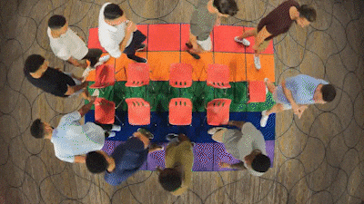

# Video Object Detection & Tracking


Real-time object detection, multi-object tracking and analytics for video files, streams and webcams.
YOLO11 does the detection on each frame, ByteTrack (or BoT-SORT) links detections into persistent
track IDs, and an analytics layer turns tracks into counts, line-crossing events and per-object stats.

```
video ──► YOLO11 detector ──► ByteTrack / BoT-SORT ──► analytics ──► annotated.mp4
 (file,      (boxes, class,       (persistent IDs,       (line          tracks.csv
  RTSP,       confidence)          trajectories)          crossings,     events.csv
  webcam)                                                 lifetimes)     summary.json
```

## Features

- **Detection:** any Ultralytics model (YOLO11 n/s/m/l/x, YOLOv8, or your own fine-tuned `.pt`), class filtering, configurable confidence / IoU / input size
- **Tracking:** ByteTrack or BoT-SORT with persistent IDs, trajectory trails, and majority-vote class smoothing (stops a track flipping between `car` and `truck`)
- **Analytics:**
  - directional line-crossing counter (segment intersection, so no double counts when a box jitters on the line)
  - unique-object counts per class, with short flicker tracks filtered out
  - per-track lifetime, duration, path length and mean confidence
- **Outputs:** H.264 annotated video that plays in a browser, CSV event logs, and a JSON run summary with latency and FPS
- **Interfaces:** a CLI, a Streamlit web demo, and a small Python API
- **Tested:** unit tests cover the geometry and analytics, which don't depend on the model

## Quickstart

```bash
python -m venv .venv && source .venv/bin/activate
pip install -r requirements.txt

# make a 6-second test clip (or use your own footage)
python scripts/make_demo_video.py

# run it
python -m vdet.cli --source data/demo.mp4 --out runs/demo
```

Model weights download automatically the first time you run it.

### More examples

```bash
# Vehicle counting with a preset
python -m vdet.cli --config configs/traffic.yaml --source traffic.mp4

# Only people, diagonal counting line, BoT-SORT tracker, on GPU
python -m vdet.cli --source mall.mp4 --classes person --line 0.2 0 0.8 1 --tracker botsort.yaml --device 0

# Webcam with a live preview window (press q to quit)
python -m vdet.cli --source 0 --show

# Faster on CPU: process every 2nd frame at 480px
python -m vdet.cli --source clip.mp4 --stride 2 --imgsz 480
```

### Web demo

```bash
streamlit run app.py
```

Upload a video, tune the model and line in the sidebar, then watch the annotated result and download the CSVs.

### Python API

```python
from vdet import PipelineConfig, VideoPipeline

cfg = PipelineConfig(model="yolo11s.pt", classes=["car", "truck"], line=(0, 0.6, 1, 0.6))
summary = VideoPipeline(cfg).run("traffic.mp4", "runs/traffic")
print(summary["line_crossings"])
```

## Outputs

| File | Contents |
|---|---|
| `annotated.mp4` | Boxes, track IDs, trails, counting line and a stats overlay |
| `tracks.csv` | One row per object: `track_id, class, first_seen_s, last_seen_s, duration_s, detections, mean_conf, path_px` |
| `events.csv` | One row per line crossing: `frame, timestamp_s, track_id, class_name, direction` |
| `summary.json` | Config, unique counts per class, crossings per class and direction, latency (mean / p95) and FPS |

## Benchmarks

Measured on the synthetic demo clip (810×540, 2-core CPU, no GPU):

| Model | imgsz | Mean inference | Inference FPS | End-to-end FPS |
|---|---|---|---|---|
| yolo11n | 640 | 53.6 ms | 18.7 | 14.9 |

Add rows for `yolo11s` / `yolo11m` and for a GPU on your own hardware. The comparison of speed against accuracy is worth showing.

## Project layout

```
vdet/
  config.py      PipelineConfig dataclass + YAML loading
  pipeline.py    VideoPipeline: read → track → analyze → annotate → write
  analytics.py   LineCounter, TrackRegistry (no torch dependency)
  annotate.py    drawing helpers (stable per-ID colors, trails, HUD)
  cli.py         command-line interface
app.py           Streamlit demo
configs/         YAML presets
scripts/         demo clip generator
tests/           pytest unit tests
```

## Design notes

- **Counting point:** the bottom-center of the box is used rather than the box center. It approximates where the object touches the ground, so counts don't depend on object height or camera tilt.
- **Normalized line coordinates:** the counting line is given in 0–1 coordinates, so one config works at any resolution.
- **Segment intersection, not a side flip:** a crossing only counts if the movement between two frames actually intersects the line *segment*. Objects passing beyond the ends of the segment aren't counted, and each track counts at most once per direction.
- **Warmup excluded:** the first inference call is left out of the latency stats because it includes one-time model setup.

## Roadmap / extensions

- [ ] **Evaluate tracking quantitatively** on MOT17 using TrackEval (HOTA, MOTA, IDF1), comparing ByteTrack with BoT-SORT
- [ ] **Fine-tune** on a domain dataset (e.g. VisDrone, UA-DETRAC) and compare mAP with the COCO baseline
- [ ] **Polygon zones** with dwell time and occupancy heatmaps
- [ ] **Speed estimation** using a homography from image to ground plane
- [ ] **Export** to ONNX / TensorRT / OpenVINO and benchmark the latency gains
- [ ] **Serve** as a FastAPI service with async job queue + Docker image
- [ ] **RTSP multi-stream** processing with batched inference

## Data sources

- Free stock footage: [Pexels Videos](https://www.pexels.com/videos/) (search "traffic", "pedestrians")
- Tracking benchmark: [MOT Challenge](https://motchallenge.net/)
- Vehicle datasets: [UA-DETRAC](https://detrac-db.rit.albany.edu/), [VisDrone](https://github.com/VisDrone/VisDrone-Dataset)

## License

The code here is MIT. Ultralytics YOLO is AGPL-3.0, so check its terms before using this commercially.
